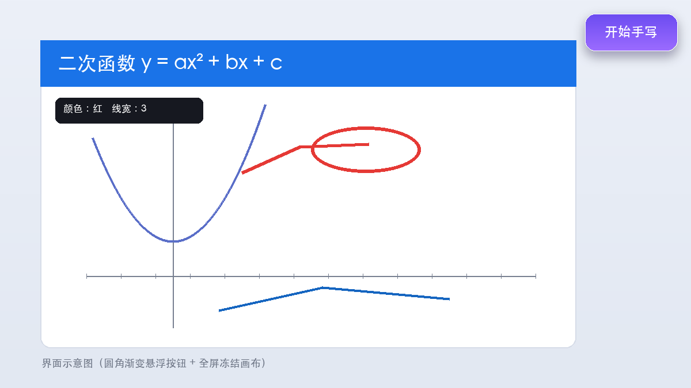

# 屏幕白板 · Screen Whiteboard

一个开源、跨平台的屏幕白板工具：屏幕右上角悬浮一个「开始手写」按钮，点击后冻结当前画面，直接用鼠标在屏幕上书写、圈画，并按需保存截图。

界面与绘制层基于 Qt 6（PySide6），按屏幕物理像素渲染，在 Retina 与高 DPI 屏幕上保持清晰；笔迹采用增量绘制与二次贝塞尔平滑，书写流畅跟手。

本项目为独立开发：代码、界面与图标均为原创，不包含任何第三方软件的代码、图片或文本资源。

[](https://github.com/tsingke/screen-whiteboard/actions/workflows/build.yml)
[](LICENSE)
[](https://www.python.org/)
[](https://www.qt.io/)
[](#平台说明)
[](https://tsingke.github.io/screen-whiteboard/)

在线主页：**https://tsingke.github.io/screen-whiteboard/**



> 上图为界面示意图，用于说明交互方式；实际界面为圆角渐变悬浮按钮 + 无边框全屏画布。

## 清晰度与性能

| 优化 | 实现 |
|---|---|
| 原生 HiDPI | 截屏与绘制全程使用物理像素，按 `devicePixelRatio` 映射，不做任何降采样 |
| 不发虚 | 背景图与笔迹层都以设备像素存储，绘制时由 Qt 直接合成 |
| 流畅书写 | 每次鼠标移动只绘制新增的一小段，并用脏矩形局部刷新，避免全屏重绘 |
| 笔迹平滑 | 相邻采样点用中点二次贝塞尔曲线连接，抬笔时补齐尾部 |
| 快速启动 | Windows 使用目录版打包，避免单文件每次解压运行时 |
| 低内存 | 笔迹层为单张透明画布，不创建大量图元对象 |

在 200% / 300% 缩放的 Windows 屏幕与 Retina Mac 上，画面边缘与细线保持锐利。

## 功能

| 功能 | 说明 |
|---|---|
| 悬浮入口 | 无边框、始终置顶的圆角渐变按钮，默认位于右上角 |
| 自由拖动 | 左键按住按钮即可拖到任意位置 |
| 快速退出 | 在按钮上单击右键退出程序 |
| 冻结标注 | 点击后截取按钮所在屏幕，在冻结画面上书写，不干扰底层窗口 |
| 颜色切换 | 红 / 绿 / 蓝 / 黄 / 黑 / 白 |
| 线宽切换 | 1 ~ 9 级 |
| 撤销 | Ctrl+Z 撤销上一笔 |
| 清空 | C 键清空全部笔迹，保留屏幕背景 |
| 截图保存 | S 键保存为 PNG / JPEG，默认文件名带时间戳 |
| 多显示器 | 可用 `--all-monitors` 截取整个虚拟桌面 |
| 无外部服务 | 不联网、不写注册表、不上传任何内容 |

## 快速开始

### 从源码运行

```bash
git clone https://github.com/tsingke/screen-whiteboard.git
cd screen-whiteboard
python -m pip install -r requirements.txt
python main.py
```

需要 Python 3.9+ 与 PySide6 6.6+。也可以安装为命令：

```bash
python -m pip install .
screen-whiteboard
```

### 使用预构建版本

在 [Releases](https://github.com/tsingke/screen-whiteboard/releases) 下载：

| 下载文件 | 内容 |
|---|---|
| `ScreenWhiteboard-v2.0.1-Windows-macOS.zip` | 双平台合集，内含 `Windows版/` 与 `macOS版/` 两个独立文件夹 |
| `ScreenWhiteboard-Windows.zip` | Windows 目录版压缩包 |
| `ScreenWhiteboard-macOS.dmg` | macOS 安装镜像 |
| `ScreenWhiteboard-macOS.zip` | macOS App 压缩包 |

合集解压后的结构：

```text
ScreenWhiteboard-v2.0.1-Windows-macOS/
├── Windows版/
│   ├── ScreenWhiteboard/
│   │   ├── ScreenWhiteboard.exe
│   │   └── ...（Qt 运行时文件）
│   ├── 使用说明.txt
│   └── LICENSE.txt
└── macOS版/
    ├── ScreenWhiteboard-macOS.dmg
    ├── ScreenWhiteboard-macOS.zip
    ├── 使用说明.txt
    └── LICENSE.txt
```

Windows 双击 `Windows版\ScreenWhiteboard\ScreenWhiteboard.exe` 运行。macOS 打开 DMG，把 `ScreenWhiteboard.app` 拖到「应用程序」；首次启动请右键点击 App 选择「打开」，并在「系统设置 → 隐私与安全性 → 屏幕录制」中授权。

## 快捷键

| 按键 | 作用 |
|---|---|
| 鼠标左键拖动 | 书写 / 画线 |
| R / G / B | 红色 / 绿色 / 蓝色 |
| Y / K / W | 黄色 / 黑色 / 白色 |
| 1 ~ 9 | 线条粗细 |
| C | 清空笔迹 |
| Ctrl+Z | 撤销上一笔 |
| S 或 Ctrl+S | 保存截图 |
| Esc | 退出标注模式 |

标注模式下左上角会短暂显示当前颜色与线宽。

## 命令行参数

```text
python main.py [--config PATH] [--offset-x N] [--offset-y N]
               [--save-dir DIR] [--all-monitors] [--no-help]
               [--print-config] [--write-config]
```

| 参数 | 说明 |
|---|---|
| `--config PATH` | 指定 JSON 配置文件 |
| `--offset-x N` | 按钮距离屏幕右侧的像素，默认 20 |
| `--offset-y N` | 按钮距离屏幕顶部的像素，默认 10 |
| `--save-dir DIR` | 截图默认保存目录 |
| `--all-monitors` | 截取全部显示器 |
| `--no-help` | 首次启动时不显示使用说明 |
| `--print-config` | 打印生效配置后退出 |
| `--write-config` | 将配置写入默认位置后退出 |

配置文件位置：

| 平台 | 路径 |
|---|---|
| Windows | `%APPDATA%\ScreenWhiteboard\config.json` |
| macOS | `~/Library/Application Support/ScreenWhiteboard/config.json` |
| Linux | `~/.config/screen-whiteboard/config.json` |

所有字段都有默认值，配置文件不是必需的。可配置项包括颜色表、默认颜色与线宽、按钮文字、渐变色、圆角、阴影、偏移、字体、保存目录等，详见 `screen_whiteboard/config.py`。

## 打包

Windows（目录版）：

```bat
build\build_windows.bat
```

macOS：

```bash
bash build/build_macos.sh
```

产物位于 `dist/`。CI 会在推送到 `main` 或打 `v*` 标签时自动构建两个平台的安装包。

## 平台说明

| 平台 | 截屏方式 | 注意事项 |
|---|---|---|
| Windows | Qt `QScreen.grabWindow` | 首次运行若被 SmartScreen 拦截，选择「更多信息 → 仍要运行」 |
| macOS | Qt `QScreen.grabWindow` | 须在「系统设置 → 隐私与安全性 → 屏幕录制」中给 App 授权；发布版为 Apple Silicon（arm64） |
| Linux | Qt `QScreen.grabWindow` | 需要可用的 X11 / Wayland 桌面；Wayland 下请确保合成器允许截屏 |

程序按目标屏幕的 `devicePixelRatio` 截取与绘制，不做缩放，因此 Retina 与高 DPI 屏幕不会发虚。多显示器且各屏缩放比例不同时，程序以主屏比例合成整张虚拟桌面。

## 项目结构

```text
screen-whiteboard/
├── main.py                        # 入口
├── screen_whiteboard/
│   ├── app.py                     # 应用调度、权限与标注层生命周期
│   ├── launcher.py                # 圆角渐变悬浮按钮
│   ├── overlay.py                 # 全屏画布、增量绘制、快捷键、保存
│   ├── strokes.py                 # 笔迹模型与 Qt 渲染
│   ├── capture.py                 # Qt 截屏与 macOS 权限
│   ├── keymap.py                  # 按键 → 动作（纯函数）
│   ├── config.py                  # 配置模型与读写
│   ├── help.py                    # 应用内使用说明与关于
│   └── platform_utils.py          # 高 DPI、字体
├── tools/
│   └── make_icons.py              # 图标与示意图生成
├── tests/                         # 单元测试
├── docs/
│   └── ui-preview.png
├── assets/                        # ICO / ICNS / PNG
├── build/                         # 打包脚本
├── packaging/                     # 发布包使用说明
└── .github/workflows/build.yml    # 测试 + 双平台构建 + Release
```

## 独立开发声明

屏幕白板是一个独立开发的开源项目：

- 全部源代码由本项目自行编写，以 MIT 许可发布
- 图标、界面示意图与说明文本均为原创
- 不包含任何第三方软件的代码、图片、文本或其他资源
- 除 Python、PySide6/Qt 等通用开源依赖外，不依赖或调用任何其他软件

本项目只提供通用的屏幕标注能力，适用于课堂板书、演示讲解和远程会议等场景。

## 开发与测试

```bash
python -m pip install -r requirements.txt
QT_QPA_PLATFORM=offscreen python -m unittest discover -s tests -v
```

测试覆盖按键映射、配置合并、笔迹渲染与标注层，共 25 项。不需要真实桌面。

## 开发者

张庆科 · tsingke@hotmail.com

项目由张庆科独立开发与维护。问题反馈或功能建议，欢迎通过 GitHub Issues 联系。

## 许可证

本项目以 MIT License 发布。

Copyright (c) 2026 张庆科 <tsingke@hotmail.com>

运行时使用 PySide6 / Qt（LGPLv3）、Python（PSF License）等开源组件，遵循各自的许可证。详见 [THIRD_PARTY_NOTICES.md](THIRD_PARTY_NOTICES.md)。

## 免责声明

本项目用于教学、演示与屏幕标注。请勿用它截取、传播未经授权的敏感信息。

## English

Screen Whiteboard is an open-source, cross-platform screen annotation tool. A small always-on-top button sits in the corner of the screen; clicking it freezes the current screen and lets you draw with the mouse. Hotkeys switch colors and pen widths, clear or undo strokes, and save the result as PNG/JPEG. Built with Python 3.9+ and Qt 6 (PySide6), it captures and renders at native device pixels, so Retina and high-DPI screens stay crisp, while incremental drawing and quadratic smoothing keep handwriting responsive. The project is independently developed; its code, icons and documentation are original. Licensed under MIT.
